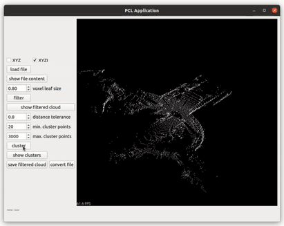
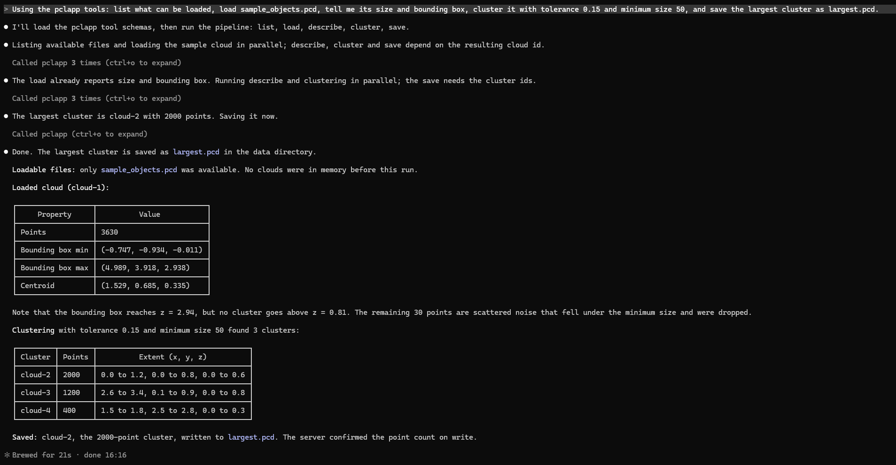
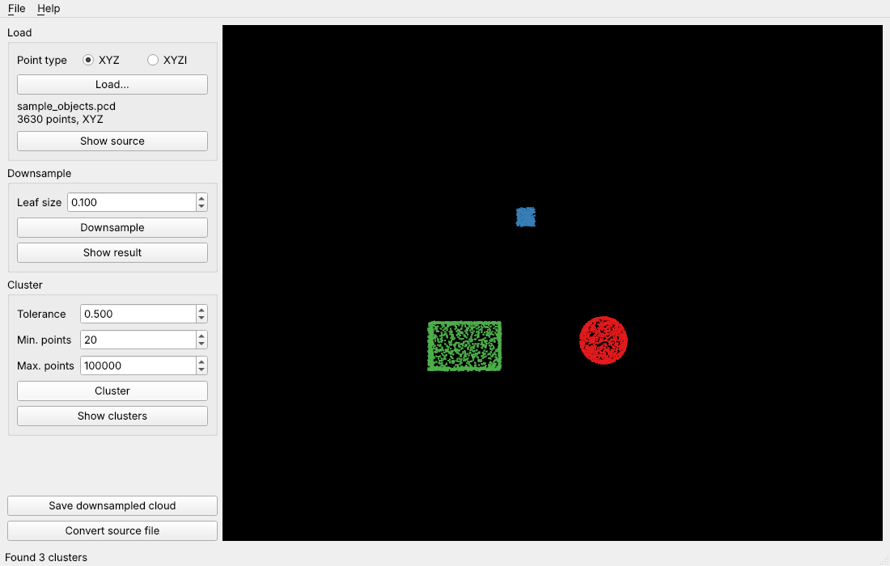

# PCL App

Loading, voxel downsampling and Euclidean clustering of point clouds, in four layers:

* a header-only **C++17 core** on top of the Point Cloud Library (PCL), with unit tests
* **Python bindings** for that core (pybind11)
* an **MCP server** that lets an LLM such as Claude load, filter and cluster clouds
  through the same code, running locally over stdio with no network access
* the original **Qt desktop application**



*The recording shows the 2021 version of the desktop application.*
Video walkthrough [here](https://drive.google.com/file/d/1E5WDR_QrXmQEPO-EXV3cmHHyO9Jrx7uP/view?usp=sharing)
*(set the quality to 720p manually)*.

## Status

The code was rewritten in C++17 in October 2026. This table lists what has
actually been built and run, and where:

| Part | Linux (Ubuntu 24.04, GCC 13, PCL 1.14) | Windows 11 (Visual Studio 2022, MSVC 19.44, PCL 1.15.1 from vcpkg) |
| --- | --- | --- |
| Core and C++ tests | builds, 8 of 8 tests pass | builds, 8 of 8 tests pass |
| Python package and tests | Python 3.11, 3.12 and 3.13: 21 of 21 tests pass | Python 3.12: 20 pass, 1 skipped (it creates a symlink, which needs extra rights on Windows) |
| MCP server used from Claude Code | not tried; covered by the tests, which drive the server with the MCP SDK's client | registered in Claude Code 2.1.296 and used to load, cluster and save the sample cloud |
| Desktop application | Qt 5.15, VTK 9.1: builds and runs; every button and all four languages checked on a virtual display | Qt 6.11.2, VTK 9.3 from vcpkg: builds and runs, language switch checked |

On every push, the CI workflow repeats the Linux build, the C++ tests, the
Python tests (with the runner's system Python) and the application build.

**What is mine and what is not.** The geometry algorithms (voxel grid filter,
Euclidean cluster extraction, bounding box, centroid, PCD I/O) are PCL's. The
design around them, described below, is mine. The 2026 rewrite, the bindings
and the MCP server were built together with [Claude Code](https://claude.com/claude-code);
the commits that came out of that work carry a `Co-Authored-By: Claude` line.

## Layout

```
core/     Header-only processing core (C++17, PCL only, no Qt)
  cloud_io.h        load/save for PCD and text, format detection, IoError
  processing.h      voxelDownsample(), euclideanClusters() as pure functions
  summary.h         summarize(): point count, bounding box, centroid
  cloud_session.h   CloudSession<PointT> owning one loaded cloud and its results;
                    AnyCloudSession = std::variant over the supported point types
python/   Python package "pclapp"
  src/bindings.cpp        pybind11 bindings for the core
  pclapp/mcp_server.py    MCP server built on the bindings
app/      Qt5 Widgets front end (MainWindow + .ui)
tests/    Catch2 tests for the core, pytest tests for the package and the server
data/     A small synthetic sample cloud and the script that generates it
```

### Design notes

* **One implementation per operation.** Point types with and without an
  intensity channel share a single code path, selected with `if constexpr`
  on PCL's field traits instead of a duplicated template specialisation.
* **Type dispatch happens once.** The UI holds an `AnyCloudSession` variant and
  every handler is a single `std::visit`. The Python bindings use the same
  idea: a `Cloud` holds an XYZ or XYZI cloud in a variant, and each function
  dispatches to the templated core with one `std::visit`.
* **Core is testable in isolation.** It has no Qt or VTK dependency, so CI
  builds and runs the tests on a plain Linux runner.
* **Errors are explicit.** File problems raise `IoError` whose message names the
  file and, for parse errors, the line. Bad parameters raise
  `std::invalid_argument`. In Python these arrive as `pclapp.IoError` and
  `ValueError`.
* **No geometry code outside the core.** The bindings only convert types, and
  the MCP server only keeps track of clouds and checks paths.

## Building the core and running the C++ tests

Requirements: CMake 3.16+ (3.21+ for the presets), a C++17 compiler and PCL 1.11+.
Qt and VTK are not needed for this part.

Linux, with PCL from the distribution (`sudo apt install libpcl-dev`):

```sh
cmake -S . -B build -DCMAKE_BUILD_TYPE=Release -DPCLAPP_BUILD_APP=OFF
cmake --build build --parallel
ctest --test-dir build --output-on-failure
```

Windows, with Visual Studio 2022 and PCL from [vcpkg](https://github.com/microsoft/vcpkg).
`VCPKG_ROOT` must point to a vcpkg checkout. The first configure builds PCL from
source, which takes a while (about half an hour on the machine used here):

```bat
set VCPKG_ROOT=C:\vcpkg
cmake --preset core-vcpkg
cmake --build --preset core-vcpkg
ctest --preset core-vcpkg
```

## Python package

`pip` builds the extension module with CMake (through scikit-build-core) and
installs it as the package `pclapp`. Python 3.10 or newer is required.

Linux (needs `libpcl-dev`, `python3-dev` and `python3-venv`):

```sh
python3 -m venv .venv
.venv/bin/pip install ".[test]"
.venv/bin/python -m pytest
```

Windows (PCL comes from vcpkg again; its DLLs are copied next to the module,
so nothing has to be added to `PATH`):

```bat
set VCPKG_ROOT=C:\vcpkg
set CMAKE_TOOLCHAIN_FILE=C:\vcpkg\scripts\buildsystems\vcpkg.cmake
python -m venv .venv
.venv\Scripts\python -m pip install ".[test]"
.venv\Scripts\python -m pytest
```

Use `pip install .` for the bindings alone, or `pip install ".[mcp]"` to add
what the MCP server needs.

```python
import pclapp

cloud = pclapp.load("data/sample_objects.pcd")      # 3630 points
small = pclapp.voxel_downsample(cloud, leaf_size=0.05)
clusters = pclapp.euclidean_cluster(cloud, tolerance=0.15, min_size=50, max_size=len(cloud))

for cluster in clusters:                             # 2000, 1200 and 400 points
    print(cluster.summary())                         # count, bounding box, centroid

pclapp.save(clusters[0], "largest.pcd")
```

## MCP server

`pclapp-mcp` (or `python -m pclapp.mcp_server`) is a
[Model Context Protocol](https://modelcontextprotocol.io) server built with the
MCP Python SDK v2. It gives a model six tools:

| Tool | What it does |
| --- | --- |
| `list_clouds` | Lists the clouds in memory and the files that can be loaded |
| `load_cloud` | Loads a `.pcd`, `.txt` or `.xyz` file and returns its id and summary |
| `describe_cloud` | Point count, bounding box, centroid and origin of a cloud |
| `downsample` | Voxel-grid downsampling; returns a new cloud |
| `cluster` | Euclidean clustering; each cluster becomes a new cloud with its own id |
| `save_cloud` | Writes a cloud to a file |

How it is confined:

* It talks over stdio only and makes no network calls.
* It reads and writes files only inside one data directory given at start-up.
  Paths that leave it through `..`, an absolute path or a symlink are refused.
* `save_cloud` does not overwrite an existing file unless asked to.
* Clouds live in the server's memory and are addressed by id (`cloud-1`,
  `cloud-2`, ...). No tool changes a cloud in place.

### Using it from Claude Code

Register the server once, with the full path of the executable in your virtual
environment and the folder it may use. On Windows:

```bat
claude mcp add --transport stdio pclapp -- "C:\path\to\PCL-App\.venv\Scripts\pclapp-mcp.exe" --data-dir "C:\path\to\PCL-App\data"
```

On Linux the executable is `.venv/bin/pclapp-mcp`. `claude mcp list` should then
show `pclapp` as connected, and `/mcp` inside a session lists the tools.

An example prompt for the sample cloud in `data/`:

> Using the pclapp tools: list what can be loaded, load sample_objects.pcd, tell
> me its size and bounding box, cluster it with tolerance 0.15 and minimum size
> 50, and save the largest cluster as largest.pcd.

This is the session in Claude Code 2.1.296 on Windows 11. Claude calls the
tools, reports 3630 points and three clusters of 2000, 1200 and 400 points, and
saves the largest one, which leaves `data/largest.pcd` with 2000 points:



The sample cloud is synthetic: a hollow box, a sphere, a small cube and 30
stray points, generated by `data/make_sample.py`. Clustering finds the three
objects and drops the stray points because they stay below the minimum size.

## Desktop application

A Qt Widgets front end around the core, with a VTK 3D view
(`QVTKOpenGLNativeWidget`, so it needs VTK 9). The panel follows the workflow:

* **Load** a `.pcd` or plain-text (`x y z [intensity]`) cloud as `PointXYZ` or `PointXYZI`
* **Downsample** with a voxel grid
* **Cluster** with Euclidean cluster extraction; each cluster is drawn in its own colour
* Save the downsampled cloud, or convert the source between `.pcd` and `.txt`

Buttons become available as the workflow allows: nothing before a file is
loaded, "Show clusters" only once clusters exist. The interface is available
in English, German, French and Spanish (Settings > Language; the choice is
remembered, the default follows the system language).



*The sample cloud after "Cluster", on Ubuntu 24.04.*

The application uses whichever Qt major version VTK was built with: Qt 5 with
the Ubuntu 24.04 packages, Qt 6 with vcpkg. The source is the same for both.

Linux (needs `libvtk9-qt-dev`, `qtbase5-dev` and `qttools5-dev-tools` in
addition to `libpcl-dev`):

```sh
cmake --preset app
cmake --build --preset app
./build-app/PclApp
```

Windows, with everything from vcpkg. The `app` feature of `vcpkg.json` adds
PCL's visualization module, VTK with Qt support and Qt 6, which vcpkg builds
from source the first time; this takes hours. This preset installs the
dependencies into vcpkg's own `installed` folder instead of the build tree:
one of them (libiconv, built with autotools) fails when the install path
contains a space, as a project folder easily does. It also tells vcpkg to
delete each package's build tree once the package is built, because the Qt
and VTK build trees take tens of gigabytes.

```bat
set VCPKG_ROOT=C:cpkg
cmake --preset app-vcpkg
cmake --build --preset app-vcpkg
build-app\Release\PclApp.exe
```
