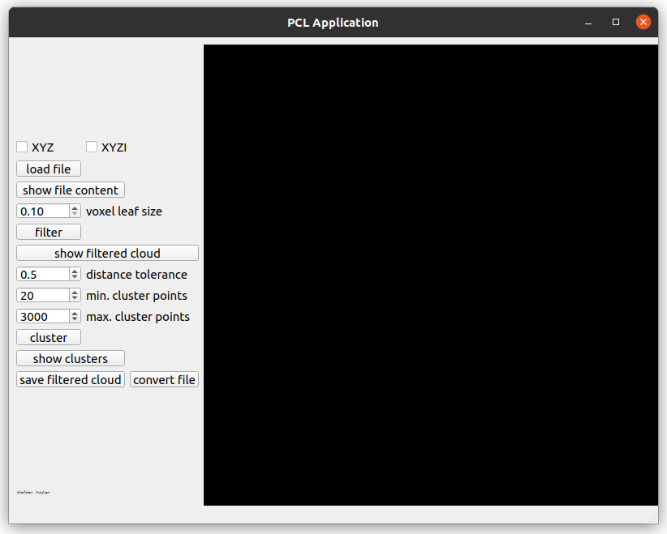

# PCL App

A small Qt desktop tool for loading, downsampling, clustering and converting
point clouds, built on the Point Cloud Library (PCL) and VTK.


*The recording shows the 2021 version of the application.*

Video walkthrough [here](https://drive.google.com/file/d/1E5WDR_QrXmQEPO-EXV3cmHHyO9Jrx7uP/view?usp=sharing)
*(set the quality to 720p manually)*.

## Status

The code was rewritten in C++17 in October 2026. What has been built and run so far:

| Part | Linux | Windows |
| --- | --- | --- |
| Core and unit tests | Ubuntu 24.04, GCC 13, PCL 1.14: builds, 7 of 7 tests pass | Windows 11, Visual Studio 2022 (MSVC 19.44), PCL 1.15.1 from vcpkg: builds, 7 of 7 tests pass |
| Desktop application | not built yet since the rewrite | not built yet since the rewrite |

The desktop application still targets Qt 5 with VTK 8 (`QVTKWidget`). VTK 9 removed
that widget, so the application has to be ported before it builds on current
toolchains. Until then, only the core is verified.

The geometry algorithms (voxel grid filter, Euclidean cluster extraction, PCD
I/O) are PCL's. The design around them, described below, is mine. The rewrite
was done together with Claude Code.

## Features

* Load `.pcd` and plain-text (`x y z [intensity]`) clouds as `PointXYZ` or `PointXYZI`
* Voxel-grid downsampling
* Euclidean cluster extraction, each cluster drawn in a distinct colour
* Save the filtered cloud, or convert the source between `.pcd` and `.txt`

## Layout

```
core/   Header-only processing core (C++17, PCL only, no Qt)
  cloud_io.h        load/save for PCD and text, format detection, IoError
  processing.h      voxelDownsample(), euclideanClusters() as pure functions
  cloud_session.h   CloudSession<PointT> owning one loaded cloud and its results;
                    AnyCloudSession = std::variant over the supported point types
app/    Qt5 Widgets front end (MainWindow + .ui)
tests/  Catch2 unit tests for the core
```

### Design notes

* **One implementation per operation.** Point types with and without an
  intensity channel share a single code path, selected with `if constexpr`
  on PCL's field traits instead of a duplicated template specialisation.
* **Type dispatch happens once.** The UI holds an `AnyCloudSession` variant and
  every handler is a single `std::visit`. Adding a point type means adding one
  alternative to the variant and one case to `openCloud()`.
* **Core is testable in isolation.** It has no Qt or VTK dependency, so CI
  builds and runs the tests on a plain Linux runner with only `libpcl-dev`.
* **Errors are explicit.** File problems raise `IoError` with the path and line
  number; bad parameters raise `std::invalid_argument`. The UI reports both.

## Building the core and running the tests

Requirements: CMake 3.16+ (3.21+ for the presets), a C++17 compiler and PCL 1.11+.
Qt and VTK are not needed for this part.

Linux, with PCL from the distribution (`sudo apt install libpcl-dev`):

```sh
cmake -S . -B build -DCMAKE_BUILD_TYPE=Release -DPCLAPP_BUILD_APP=OFF
cmake --build build --parallel
ctest --test-dir build --output-on-failure
```

Windows, with Visual Studio 2022 and PCL from [vcpkg](https://github.com/microsoft/vcpkg).
`VCPKG_ROOT` must point to a vcpkg checkout. The first configure builds PCL from
source, which takes a while (about half an hour on the machine used here):

```bat
cmake --preset core-vcpkg
cmake --build --preset core-vcpkg
ctest --preset core-vcpkg
```

## Building the desktop application

Not possible on current toolchains yet, see [Status](#status). The application
needs Qt 5 Widgets and VTK 8 in addition to PCL, and is switched on with
`-DPCLAPP_BUILD_APP=ON` (the default when the option is not given).

## Application layout


